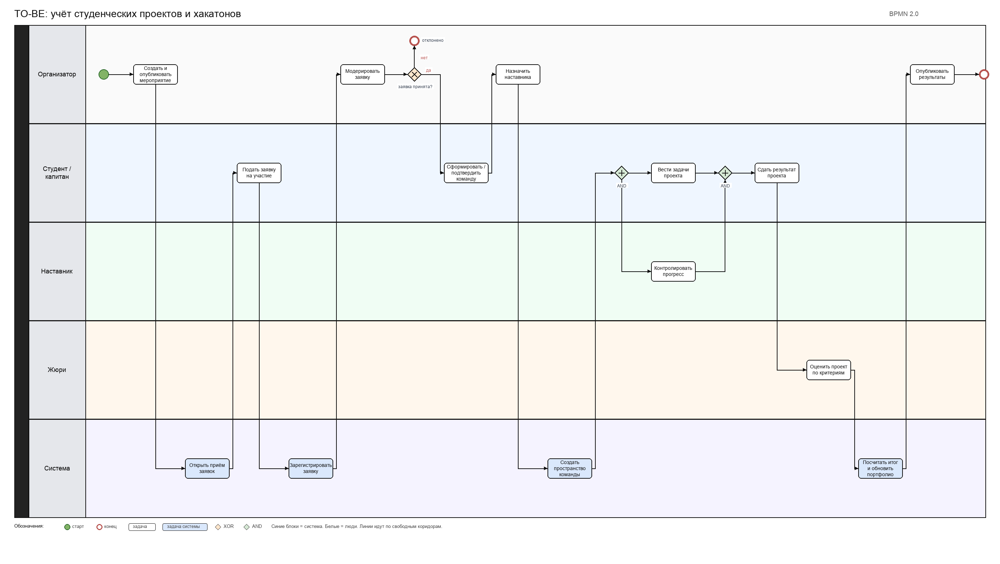

# Концепция информационной системы

## Учёт студенческих проектов и хакатонов

**Дисциплина:** Проектирование информационных систем  
**Практическая работа:** Разработка концепции ИС  
**Вариант:** 5  
**Стадия по ГОСТ Р 59793-2021:** 2. Разработка концепции АС

### Состав команды и роли

| Участник | Роль |
|---|---|
| Соколов Никита | Руководитель проекта |
| Ашур Амир | Бизнес- и системный аналитик |
| Криличевский Максим | Архитектор |
| Медолазов Андрей | Специалист по ИБ, представитель заказчика |

### Условные ограничения заказчика

| Параметр | Значение |
|---|---|
| Бюджет на создание | до 450 тыс. руб. |
| Срок ввода в эксплуатацию | до 5 месяцев |
| Число пользователей на старте | до 500 (студенты, наставники, организаторы, жюри) |
| Размещение данных | серверы в РФ |
| Горизонт ТЭО | 3 года |

---

## 1. Характеристика объекта автоматизации и требования пользователя

### 1.1. Объект автоматизации

Объект: процессы организации студенческих проектов и хакатонов в вузе (или на базе студенческого клуба / ЦКР).

Участники процесса:
- студент (участник или капитан команды);
- наставник (ментор проекта);
- организатор мероприятия;
- член жюри;
- партнёр (опционально: куратор от компании).

Типовой цикл: анонс мероприятия → подача заявок → формирование команд → работа над проектом → оценка жюри → фиксация результатов и портфолио.

### 1.2. Проблемы AS-IS

Сейчас процесс чаще всего идёт через чаты, почту и разрозненные таблицы.

1. Заявки на участие приходят в разных каналах и теряются.
2. Состав команд и роли внутри команды не зафиксированы в одном месте.
3. Нет единого трекинга задач: прогресс виден только по переписке.
4. Оценка жюри собирается вручную, сложно свести баллы и избежать ошибок.
5. Нет удобного портфолио проектов для студентов и отчётности для организаторов.
6. Партнёрам сложно отслеживать статус проектов, которые они курируют.
7. Статистика по мероприятиям (число команд, доходимость, оценки) собирается долго и вручную.

### 1.3. Требования пользователя

**Функциональные**
1. Регистрация мероприятий (хакатон, учебный проект, внутренний конкурс).
2. Подача и модерация заявок на участие.
3. Формирование команд, назначение ролей и наставника.
4. Трекинг задач команды (статусы, дедлайны).
5. Оценка проектов жюри по критериям, сводная таблица баллов.
6. Портфолио участника: проекты, роли, результаты.
7. Отчёты для организатора: заявки, команды, прогресс, итоги.

**Нефункциональные**
1. Веб-доступ с ПК и мобильных браузеров.
2. Время отклика основных экранов не более 2 с при 50 одновременных пользователях.
3. Разграничение прав по ролям.
4. Резервное копирование данных не реже 1 раза в сутки.
5. Соответствие 152-ФЗ при обработке персональных данных.

**Ограничения**
1. Бюджет и срок - см. таблицу выше.
2. Данные на серверах в РФ.
3. По возможности интеграция с корпоративной почтой / SSO вуза на следующих этапах.

### 1.4. Обязательные требования (Must)

Вариант, который не закрывает Must, из сравнения исключается.

| Код | Требование Must |
|---|---|
| M1 | Учёт мероприятий, заявок и команд в одной системе |
| M2 | Разграничение ролей: студент, наставник, организатор, жюри |
| M3 | Оценка жюри с сохранением баллов |
| M4 | Базовая отчётность для организатора |
| M5 | Размещение данных в РФ и учёт требований 152-ФЗ |

---

## 2. Аналитический обзор аналогов и готовых решений

Сравнивались решения, которые реально используют для хакатонов, учебных проектов и командной работы.

| Критерий | Google Sheets + формы | Notion / YouGile | Jira + Confluence | Devpost | Своя разработка |
|---|---|---|---|---|---|
| Заявки и команды | частично | да | через донастройку | да | да |
| Трекинг задач | слабо | да | сильно | слабо | да (нужный объём) |
| Оценка жюри | вручную | вручную / шаблоны | слабо из коробки | да | да |
| Портфолио | нет | частично | нет | да | да |
| Модель оплаты | бесплатно / Workspace | подписка | дорого для вуза | freemium / платно | разовые затраты на разработку |
| Данные в РФ | зависит от тарифа | часто зарубежные ЦОД | часто зарубежные ЦОД | зарубежные | можно обеспечить |
| Интеграции | слабые | API есть | сильные | ограничены | по потребности |
| Срок запуска | дни | 1-3 недели | 1-2 месяца | дни | 3-5 месяцев |

Краткий вывод: коробочные трекеры закрывают задачи команд, но слабо закрывают хакатонный контур (заявки, жюри, портфолио) и часто не дают размещения в РФ без доп. условий. Специализированные платформы хакатонов сильны в заявках и оценке, но слабее в учебном трекинге. Нулевой вариант на таблицах дёшев, но не снимает основные проблемы масштаба.

---

## 3. Альтернативные варианты концепции ИС

Рассмотрены три содержательно разных варианта.

### Вариант A. Организационный (нулевой)

**Идея:** единый регламент + шаблоны Google Sheets / Яндекс Таблицы + формы заявок. Без новой ИС.

**Функции:** заявки в форме, лист команд, лист задач, лист оценок жюри, инструкция для ролей.

**Архитектура:** облачные таблицы, доступ по ссылкам и правам папок.

**Ресурсы:** 1 методист + куратор, около 0,5 чел.-мес.  
**Стоимость создания:** ~30 тыс. руб. (время персонала).  
**Эксплуатация в год:** ~20 тыс. руб.  
**Срок ввода:** 0,5-1 месяц.

**Плюсы:** дёшево, быстро, понятно.  
**Минусы:** ошибки сведения, слабый контроль прав, нет удобного портфолио, плохо масштабируется, зависимость от дисциплины людей.

Must: M1 и M3 закрываются формально, M2 и M5 - слабо (права и персональные данные в таблицах трудно контролировать).

### Вариант B. Готовое решение (SaaS / коробочный контур)

**Идея:** YouGile или аналог для задач + отдельная форма заявок + свод оценок. При необходимости лёгкая интеграция через таблицы/API.

**Функции:** доски задач, роли в пространстве, заявки через форму, оценка жюри в отдельном контуре, отчёты ограниченно.

**Архитектура:** облачный SaaS, браузерный клиент, приглашения по почте.

**Ресурсы:** аналитик + админ, около 1,5 чел.-мес. на внедрение и регламенты.  
**Стоимость создания / внедрения:** ~80-120 тыс. руб.  
**Эксплуатация в год:** ~90-150 тыс. руб. (подписки + администрирование).  
**Срок ввода:** 1,5-2 месяца.

**Плюсы:** быстрый старт, зрелый трекинг, меньше разработки.  
**Минусы:** хакатонный контур собран из кусков, риск размещения данных и вендора, портфолио и отчёты жюри придётся достраивать процессом.

Must: M1-M4 в целом достижимы при дисциплине процесса; M5 нужно отдельно подтверждать у вендора.

### Вариант C. Собственная разработка (веб-приложение)

**Идея:** веб-ИС под контур мероприятий вуза: мероприятия, заявки, команды, задачи, жюри, портфолио, отчёты. Данные на сервере в РФ.

**Функции:** полный Must-набор + базовые уведомления на почту.

**Архитектура (укрупнённо):** клиент-сервер, веб-фронт, backend API, реляционная БД, роли и аутентификация. Возможна дальнейшая стыковка с SSO вуза.

**Ресурсы:** команда 3-4 человека, около 6-8 чел.-мес.  
**Стоимость создания:** ~380-420 тыс. руб.  
**Эксплуатация в год:** ~70-100 тыс. руб. (хостинг, сопровождение).  
**Срок ввода:** 4-5 месяцев (MVP).

**Плюсы:** закрывает предметную область целиком, контроль данных и ИБ, развитие под вуз.  
**Минусы:** дороже и дольше на старте, нужны сопровождение и тестирование.

Must: M1-M5 закрываются полностью.

### Сводная таблица вариантов

| Параметр | A | B | C |
|---|---|---|---|
| Идея | регламент и таблицы | SaaS-трекер + формы | своё веб-приложение |
| Автоматизация | минимальная | задачи хорошо, остальное частично | полный контур |
| Архитектура | таблицы | облачный SaaS | web + API + БД в РФ |
| Трудоёмкость | 0,5 чел.-мес. | 1,5 чел.-мес. | 6-8 чел.-мес. |
| Создание, тыс. руб. | 30 | 100 | 400 |
| Эксплуатация в год, тыс. руб. | 20 | 120 | 85 |
| Срок ввода, мес. | 1 | 2 | 5 |
| Достоинства | дёшево, быстро | быстрый трекинг | полный Must, контроль данных |
| Недостатки | ручной труд, ошибки | сборка из частей, вендор | срок и стоимость создания |

---

## 4. Сравнение вариантов и обоснование выбора

### 4.1. Критерии и веса

Критерии и веса согласованы с представителем заказчика (Медолазов Андрей).

| Критерий | Вес |
|---|---|
| Покрытие требований (в т.ч. Must) | 0,30 |
| Стоимость владения за 3 года | 0,20 |
| Срок ввода | 0,15 |
| Возможность интеграции | 0,10 |
| Безопасность и 152-ФЗ | 0,15 |
| Масштабируемость | 0,05 |
| Зависимость от поставщика | 0,05 |
| Итого | 1,00 |

Оценка по шкале 1-5 (5 лучше для проекта с учётом смысла критерия: для стоимости и зависимости от поставщика 5 = выгоднее / независимее).

### 4.2. Таблица взвешенных оценок

| Критерий | Вес | A | B | C |
|---|---|---|---|---|
| Покрытие требований | 0,30 | 2 | 3 | 5 |
| Стоимость владения за 3 года | 0,20 | 5 | 2 | 3 |
| Срок ввода | 0,15 | 5 | 4 | 2 |
| Интеграция | 0,10 | 1 | 3 | 5 |
| Безопасность, 152-ФЗ | 0,15 | 2 | 3 | 5 |
| Масштабируемость | 0,05 | 1 | 4 | 5 |
| Зависимость от поставщика | 0,05 | 4 | 2 | 5 |
| **Итог S** | **1,00** | **2,95** | **2,95** | **4,15** |

Расчёт для C:  
0,30×5 + 0,20×3 + 0,15×2 + 0,10×5 + 0,15×5 + 0,05×5 + 0,05×5 = 1,50 + 0,60 + 0,30 + 0,50 + 0,75 + 0,25 + 0,25 = **4,15**

Расчёт для A:  
0,30×2 + 0,20×5 + 0,15×5 + 0,10×1 + 0,15×2 + 0,05×1 + 0,05×4 = 0,60 + 1,00 + 0,75 + 0,10 + 0,30 + 0,05 + 0,20 = **2,95**

Расчёт для B:  
0,30×3 + 0,20×2 + 0,15×4 + 0,10×3 + 0,15×3 + 0,05×4 + 0,05×2 = 0,90 + 0,40 + 0,60 + 0,30 + 0,45 + 0,20 + 0,10 = **2,95**

**Выбор: вариант C.**

### 4.3. Устойчивость выбора

Проверка: вес покрытия требований снижен с 0,30 до 0,25, добавленные 0,05 отданы сроку ввода (вес срока 0,20).

Новые итоги: A = 3,10; B = 3,00; C = 4,00.  
Лидер не меняется. Выбор устойчив.

### 4.4. Матрица соответствия требованиям

| Требование | A | B | C |
|---|---|---|---|
| M1 Учёт мероприятий, заявок, команд | частично | да | да |
| M2 Роли | слабо | да | да |
| M3 Оценка жюри | частично | частично | да |
| M4 Отчётность | слабо | частично | да |
| M5 Данные в РФ, 152-ФЗ | риск | риск / уточнять | да |
| Трекинг задач | слабо | да | да |
| Портфолио | нет | слабо | да |

---

## 5. Описание выбранной концепции и модель процессов TO-BE

### 5.1. Выбранная концепция

Выбран вариант C: собственное веб-приложение для учёта студенческих проектов и хакатонов.

Контур MVP:
1. Организатор создаёт мероприятие и регламент оценки.
2. Студенты подают заявки, организатор модерирует.
3. Формируются команды, назначаются наставники.
4. Команды ведут задачи в системе.
5. Жюри выставляет оценки по критериям.
6. Система считает итог, формирует результаты и записи в портфолио.
7. Организатор получает отчёты.

Границы системы:
- внутри: заявки, команды, задачи, оценки, портфолио, отчёты;
- снаружи на MVP: оплата партнёрских взносов, сложный SSO (закладывается как развитие), внешние CI/CD репозиториев команд.

### 5.2. Как TO-BE закрывает проблемы AS-IS

| Проблема AS-IS | Что меняется в TO-BE |
|---|---|
| Заявки теряются | единый канал подачи и статусы |
| Состав команд размыт | карточка команды и роли |
| Прогресс только в чатах | трекинг задач со статусами |
| Ошибки сведения оценок | форма оценок и автоподсчёт |
| Нет портфолио | профиль участника с историей |
| Долгая статистика | отчёты организатора |

### 5.3. Модель процесса TO-BE (BPMN 2.0)

Диаграмма строится в нотации BPMN 2.0 (Camunda Modeler / draw.io).

Дорожки (lanes): Студент / капитан, Наставник, Организатор, Жюри, Система.

Укрупнённый поток:
1. Старт: организатор публикует мероприятие.
2. Студент подаёт заявку.
3. Шлюз: заявка принята или отклонена.
4. Формирование / подтверждение команды, назначение наставника.
5. Работа над проектом: создание и закрытие задач, контроль наставником.
6. Сдача результата.
7. Оценка жюри, расчёт итогов системой.
8. Публикация результатов и обновление портфолио.
9. Конец.

Ручные шаги: содержательная экспертиза заявки, менторская помощь, выставление экспертных оценок.  
Автоматизированные шаги: регистрация сущностей, статусы, уведомления, подсчёт баллов, отчёты, портфолио.

Исходник диаграммы: `images/05_bpmn_to_be.drawio` (открывается в diagrams.net / draw.io).

---

## 6. Ожидаемые эффекты и технико-экономическое обоснование

### 6.1. Допущения расчёта

- Горизонт: 3 года.
- Создание (вариант C): 400 тыс. руб.
- Эксплуатация: 85 тыс. руб. / год.
- Мероприятий в год: 8.
- Команд на мероприятие в среднем: 25.
- Экономия времени организаторов и волонтёров за счёт отказа от ручного сведения заявок, команд и оценок: ориентир 180 чел.-час. / год.
- Стоимость часа сотрудника оргкомитета (условно): 600 руб.
- Снижение потерь из-за ошибок и повторных уточнений: ориентир 40 тыс. руб. / год.

Источники ориентиров стоимости: публичные вилки ставок junior/middle на учебные проекты, тарифы VPS в РФ, типовые цены SaaS-трекеров для сравнения альтернатив.

### 6.2. TCO и показатели

**TCO за 3 года (C):**  
400 + 85×3 = **655 тыс. руб.**

Для сравнения:
- A: 30 + 20×3 = 90 тыс. руб. (но Must закрыт слабо, эффект ниже).
- B: 100 + 120×3 = 460 тыс. руб. (при этом остаются разрывы по жюри/портфолио/данным).

**Годовой денежный эффект (E) для C:**  
180×600 + 40 = 108 + 40 = **148 тыс. руб. / год**

**Срок окупаемости:**  
400 / 148 ≈ **2,7 года**

**ROI за 3 года:**  
(148×3 - 655) / 655 = (444 - 655) / 655 ≈ **-32%** в узком денежном контуре.

Пояснение: при учебной нагрузке вуза чистый денежный ROI на горизонте 3 лет может быть около нуля или отрицательным. Целесообразность опирается на обязательные эффекты качества процесса и отчётности. При росте числа мероприятий до 12 и более в год окупаемость улучшается примерно пропорционально эффекту.

### 6.3. Неденежные эффекты и KPI

| Эффект | Как измерить | Целевой KPI через 6 мес. после запуска |
|---|---|---|
| Прозрачность заявок | доля заявок только в системе | ≥ 95% |
| Контроль сроков задач | доля команд с актуальным трекингом | ≥ 80% |
| Качество оценки | доля проектов с полным комплектом оценок жюри | ≥ 98% |
| Скорость отчётности | время сборки итогового отчёта по мероприятию | ≤ 1 часа |
| Портфолио | доля участников с карточкой проекта после финала | ≥ 90% |

---

## 7. Реестр рисков и меры реагирования

Шкала: вероятность P и влияние I от 1 до 5. Уровень R = P×I.  
15-25 высокий, 8-14 средний, 1-7 низкий.

| № | Риск | Категория | P | I | R | Стратегия | Меры | Ответственный |
|---|---|---|---|---|---|---|---|---|
| 1 | Срыв срока MVP из-за расширения объёма | организационный | 4 | 4 | 16 | снизить | жёсткий backlog MVP, еженедельный контроль объёма | Соколов Н. |
| 2 | Превышение бюджета разработки | финансовый | 3 | 4 | 12 | снизить | резерв 15%, приоритизация Must | Соколов Н. |
| 3 | Низкая вовлечённость наставников | организационный | 3 | 4 | 12 | снизить | простой интерфейс, короткие инструкции, напоминания | Ашур А. |
| 4 | Ошибки в модели ролей и прав | технический / ИБ | 3 | 5 | 15 | снизить | матрица доступа, тест ролей до пилота | Медолазов А. |
| 5 | Утечка персональных данных участников | ИБ / правовой | 2 | 5 | 10 | снизить | минимизация ПДн, шифрование канала, регламент доступа, резервы | Медолазов А. |
| 6 | Неготовность инфраструктуры вуза вовремя | технический | 3 | 3 | 9 | снизить | ранний запрос VPS/домена, запасной хостинг в РФ | Криличевский М. |
| 7 | Сопротивление переходу с чатов и таблиц | организационный | 4 | 3 | 12 | снизить | пилот на одном хакатоне, обучение оргкомитета | Ашур А. |
| 8 | Неточные критерии оценки жюри | организационный | 3 | 3 | 9 | снизить | шаблон критериев до старта, пробная оценка | Ашур А. |
| 9 | Задержка согласований внутри вуза | административный | 3 | 4 | 12 | снизить | заранее список согласующих, буфер в плане | Соколов Н. |
| 10 | Технический долг после MVP | технический | 3 | 3 | 9 | принять / снизить | список долга, 20% времени на сопровождение | Криличевский М. |

---

## 8. Порядок оценки качества и условия приёмки

### 8.1. Показатели качества для приёмки

| Показатель | Целевое значение | Способ проверки |
|---|---|---|
| Время подачи заявки | ≤ 3 минут у нового пользователя | хронометраж на пилоте, 10 пользователей |
| Доля заявок со статусом в системе | 100% в рамках пилотного мероприятия | выгрузка и сверка с оргкомитетом |
| Корректность подсчёта баллов жюри | расхождение с ручным контролем = 0 | тест на 3 проектах с известными оценками |
| Время отклика ключевых страниц | ≤ 2 с при 50 одновременных пользователях | нагрузочный сценарий / замеры |
| Разграничение прав | нет доступа к чужим оценкам и персональным данным вне роли | тест-кейсы по ролям |
| Резервное копирование | успешный бэкап раз в сутки | журнал бэкапов за 7 дней |
| Сборка итогового отчёта | ≤ 1 часа после закрытия оценок | контрольный прогон на пилоте |

### 8.2. Укрупнённый порядок приёмки

1. Предварительные испытания командой разработки (функциональные сценарии Must).
2. Испытания с участием организатора и наставника на пилотном мероприятии.
3. Проверка ИБ и прав доступа.
4. Фиксация замечаний, устранение блокирующих.
5. Итоговая приёмка: акт + перечень выполненных показателей качества.

Эти показатели переносятся в ТЗ на следующей практической работе.

---

## 9. Выводы

1. Объект автоматизации - контур студенческих проектов и хакатонов с ролями студента, наставника, организатора и жюри.
2. Сравнение трёх альтернатив показало: таблицы слишком слабы по контролю и масштабу, SaaS быстро закрывает задачи, но не весь предметный контур и даёт риски по данным, собственная разработка лучше закрывает Must.
3. По методу взвешенных оценок выбран вариант C (S = 4,15). Выбор устойчив при сдвиге весов.
4. Целевой процесс TO-BE убирает потерю заявок, ручное сведение оценок и отсутствие портфолио; границы MVP зафиксированы.
5. ТЭО показывает умеренный денежный эффект и сильные качественные KPI. Для вуза решение целесообразно при приоритете управляемости мероприятий и отчётности.
6. Ключевые риски связаны со сроком, правами доступа, вовлечённостью и ПДн; для них заданы меры и ответственные.
7. Показатели приёмки измеримы и готовы к переносу в техническое задание.

---

## Список источников

1. ГОСТ Р 59793-2021. Автоматизированные системы. Стадии создания.
2. ГОСТ 34.602-2020. Техническое задание на создание автоматизированной системы.
3. Методические указания к практической работе Разработка концепции информационной системы.
4. Варианты ИС для разработки концепции (вариант 5).
5. Публичные материалы по BPMN 2.0: обзоры и руководства (Habr, Stormbpmn, Яндекс Практикум).
6. Публичные тарифы и описания YouGile, Jira, Devpost, облачных таблиц - для ориентиров сравнения (актуализировать даты просмотра перед защитой).

---

## Приложения

### Приложение А. Распределение работ по ролям

| Раздел отчёта | Основной исполнитель |
|---|---|
| 1. Объект и требования | Ашур А. |
| 2. Обзор аналогов | Криличевский М. |
| 3. Варианты концепции | Криличевский М., Соколов Н. |
| 4. Сравнение и выбор | Соколов Н., Медолазов А. |
| 5. TO-BE BPMN | Ашур А. |
| 6. ТЭО | Соколов Н. |
| 7. Риски | Медолазов А. |
| 8. Приёмка | Медолазов А., Ашур А. |
| Сборка Markdown, защита | вся команда |

### Приложение Б. Диаграмма BPMN

В папке `images/` лежит только модель TO-BE:
- `05_bpmn_to_be.png` — картинка для отчёта
- `05_bpmn_to_be.drawio` — исходник для diagrams.net / draw.io
