# Модель бизнес-процессов с учётом внедрения ИС

## Учёт студенческих проектов и хакатонов

**Дисциплина:** Проектирование информационных систем  
**Практическая работа:** Задание 3. Разработка модели бизнес-процессов  
**Вариант:** 5  
**Связь с заданием 2:** концепция собственной веб-ИС (вариант C)

### Состав команды и роли

| Участник | Роль |
|---|---|
| Соколов Никита | Руководитель проекта |
| Ашур Амир | Бизнес- и системный аналитик |
| Криличевский Максим | Архитектор |
| Медолазов Андрей | Специалист по ИБ, представитель заказчика |

### Кратко о предмете

Объект: организация студенческих проектов и хакатонов.  
В задании 2 выбран вариант C: собственное веб-приложение для мероприятий, заявок, команд, задач, оценки жюри, портфолио и отчётов.

Ниже построены модели IDEF0 до и после внедрения этой ИС.

Обозначения IDEF0:
- слева вход (зелёные подписи);
- сверху управление (синие подписи);
- справа выход (оранжевые подписи);
- снизу механизм (фиолетовые подписи).

На всех диаграммах подписана каждая стрелка. Розовые подписи между блоками показывают, какая информация выходит из предыдущего шага и входит в следующий.

---

## 1. AS-IS. Диаграмма A-0 (до внедрения ИС)

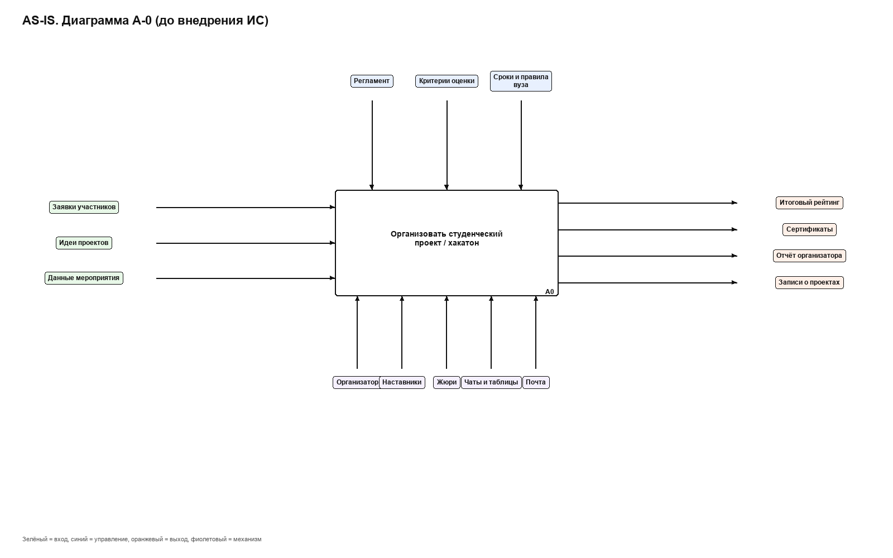

**Пояснение.**  
Один блок A0 описывает весь процесс организации мероприятия.  
Входы: заявки, идеи проектов, данные о мероприятии.  
Управление: регламент, критерии оценки, сроки и правила вуза.  
Выходы: рейтинг, сертификаты, отчёт, записи о проектах.  
Механизмы: организатор, наставники, жюри, чаты и таблицы, почта.  
ИС ещё нет, поэтому основной контур данных держится на людях и разрозненных файлах.

---

## 2. AS-IS. Декомпозиция A0 (первый уровень)

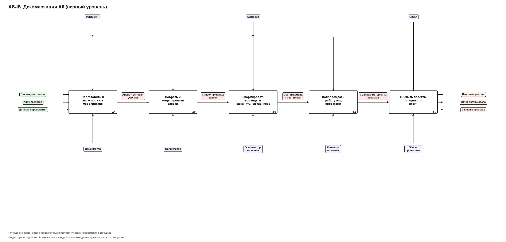

Блоки первого уровня:

| Код | Функция |
|---|---|
| A1 | Подготовить и анонсировать мероприятие |
| A2 | Собрать и модерировать заявки |
| A3 | Сформировать команды и назначить наставников |
| A4 | Сопровождать работу над проектами |
| A5 | Оценить проекты и подвести итоги |

**Пояснение.**  
Процесс разбит на 5 последовательных функций. Между блоками передаются промежуточные результаты: анонс, список заявок, состав команд, ход работы, материалы к оценке.  
Слабые места AS-IS: заявки приходят из разных каналов, статусы теряются, оценки сводятся вручную, портфолио почти не формируется.

---

## 3. AS-IS. Декомпозиция блока A2

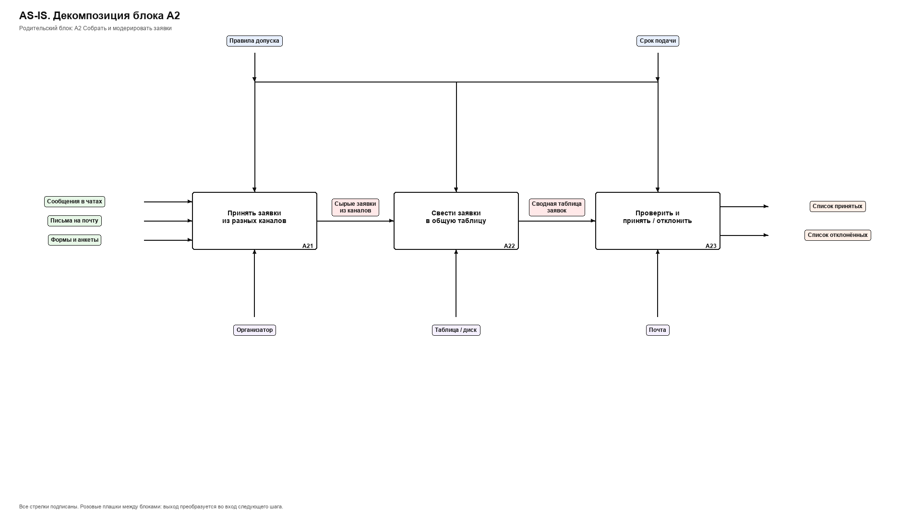

| Код | Функция |
|---|---|
| A21 | Принять заявки из разных каналов |
| A22 | Свести заявки в общую таблицу |
| A23 | Проверить и принять / отклонить |

**Пояснение.**  
Показывает, почему заявки теряются: сначала сбор из чатов и почты, затем ручное сведение, затем решение организатора. Нет единого статуса заявки и автоматических уведомлений.

---

## 4. AS-IS. Декомпозиция блока A3

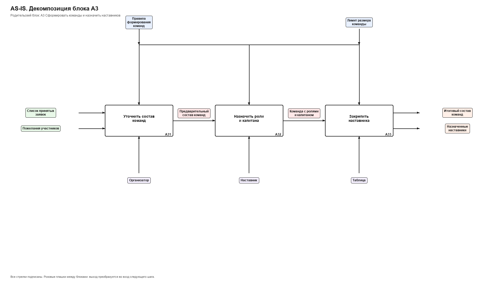

| Код | Функция |
|---|---|
| A31 | Уточнить состав команд |
| A32 | Назначить роли и капитана |
| A33 | Закрепить наставника |

**Пояснение.**  
Состав команд и наставники фиксируются вручную. Легко получить расхождения между чатом, таблицей и фактическим составом.

---

## 5. AS-IS. Декомпозиция блока A4

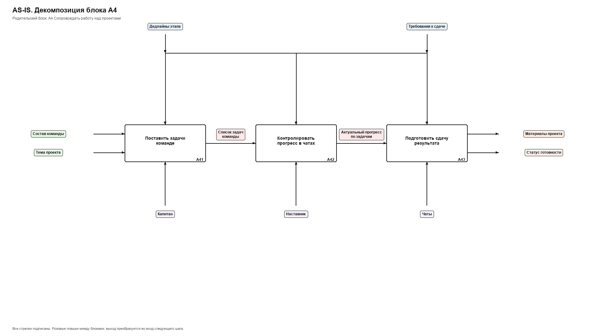

| Код | Функция |
|---|---|
| A41 | Поставить задачи команде |
| A42 | Контролировать прогресс в чатах |
| A43 | Подготовить сдачу результата |

**Пояснение.**  
Прогресс виден только по переписке. Нет единого трекинга задач и прозрачного статуса готовности для организатора.

---

## 6. AS-IS. Декомпозиция блока A5

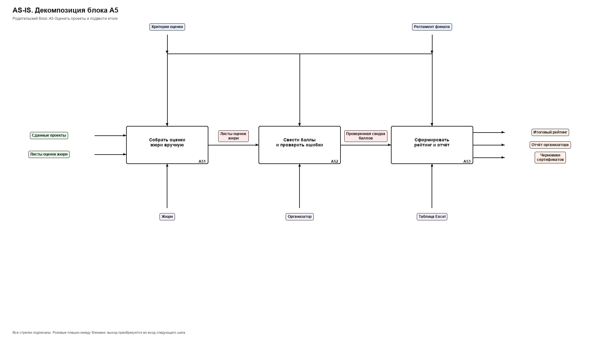

| Код | Функция |
|---|---|
| A51 | Собрать оценки жюри вручную |
| A52 | Свести баллы и проверить ошибки |
| A53 | Сформировать рейтинг и отчёт |

**Пояснение.**  
Оценка зависит от ручного сбора листов и сведения в таблице. Ошибки подсчёта и задержки отчёта типичны для AS-IS.

---

## 7. TO-BE. Диаграмма A-0 (после внедрения ИС)

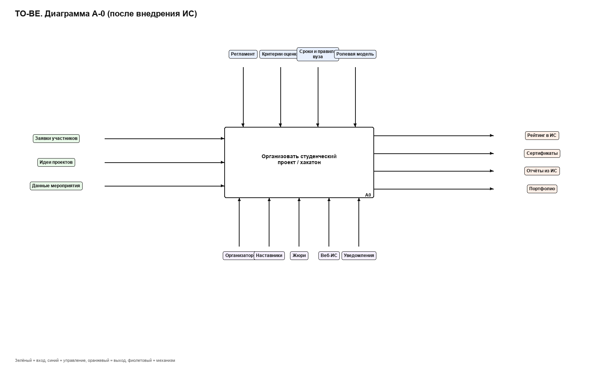

**Пояснение.**  
Граница процесса та же, но меняются управление и механизмы.  
Добавляются ролевая модель доступа и веб-ИС как основной механизм учёта.  
Выходы становятся цифровыми: рейтинг в ИС, отчёты из ИС, портфолио участников.  
Чаты и таблицы перестают быть главным контуром.

---

## 8. TO-BE. Декомпозиция A0 (первый уровень)

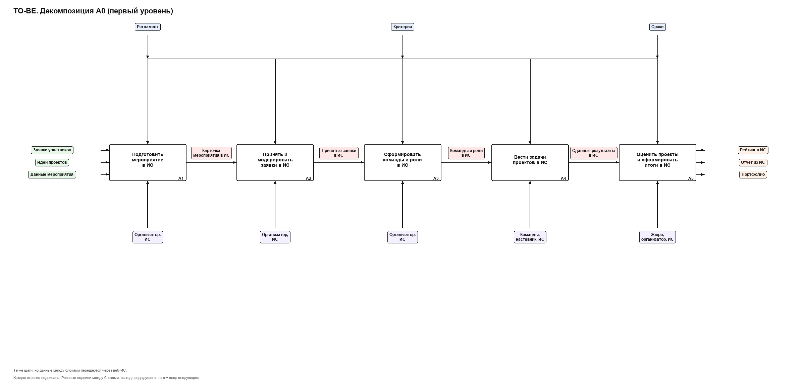

| Код | Функция |
|---|---|
| A1 | Подготовить мероприятие в ИС |
| A2 | Принять и модерировать заявки в ИС |
| A3 | Сформировать команды и роли в ИС |
| A4 | Вести задачи проектов в ИС |
| A5 | Оценить проекты и сформировать итоги в ИС |

**Пояснение.**  
Структура из 5 блоков сохранена специально, чтобы сравнивать с AS-IS один в один.  
Отличие: каждая функция опирается на ИС. Статусы, права, уведомления и отчёты ведутся централизованно.

---

## 9. TO-BE. Декомпозиция блока A2

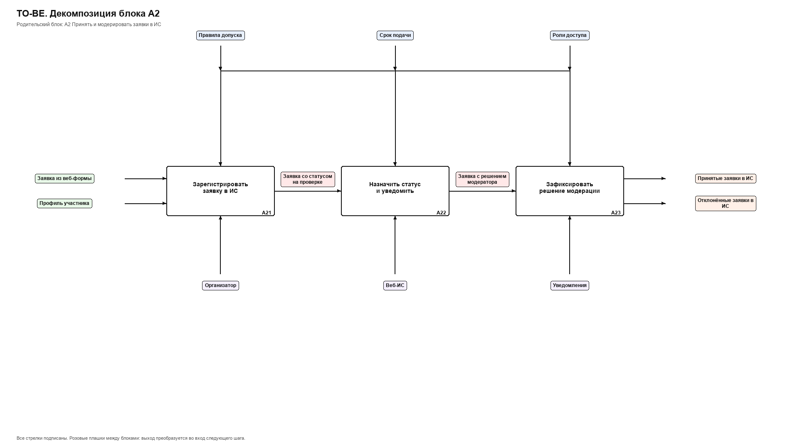

| Код | Функция |
|---|---|
| A21 | Зарегистрировать заявку в ИС |
| A22 | Назначить статус и уведомить |
| A23 | Зафиксировать решение модерации |

**Пояснение.**  
Единый канал подачи через веб-форму. Статус заявки и уведомление участнику фиксируются в системе. Организатор модерирует внутри ИС, а не в переписке.

---

## 10. TO-BE. Декомпозиция блока A3

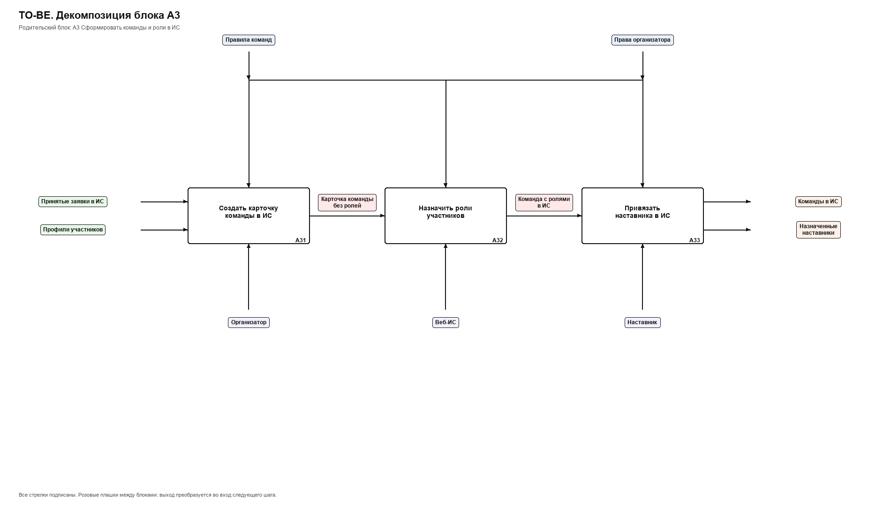

| Код | Функция |
|---|---|
| A31 | Создать карточку команды в ИС |
| A32 | Назначить роли участников |
| A33 | Привязать наставника в ИС |

**Пояснение.**  
Команда, роли и наставник хранятся в одном месте. Организатор и наставник видят актуальный состав без сверки таблиц.

---

## 11. TO-BE. Декомпозиция блока A4

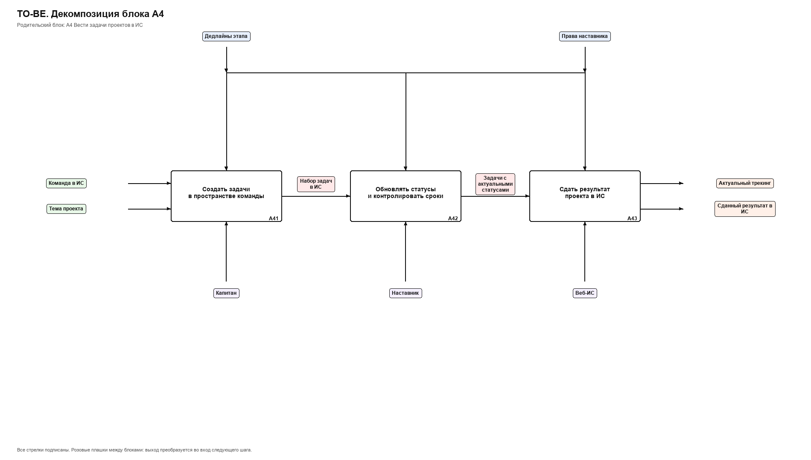

| Код | Функция |
|---|---|
| A41 | Создать задачи в пространстве команды |
| A42 | Обновлять статусы и контролировать сроки |
| A43 | Сдать результат проекта в ИС |

**Пояснение.**  
Трекинг задач и сдача результата идут в ИС. Наставник контролирует сроки по статусам, а не по переписке.

---

## 12. TO-BE. Декомпозиция блока A5

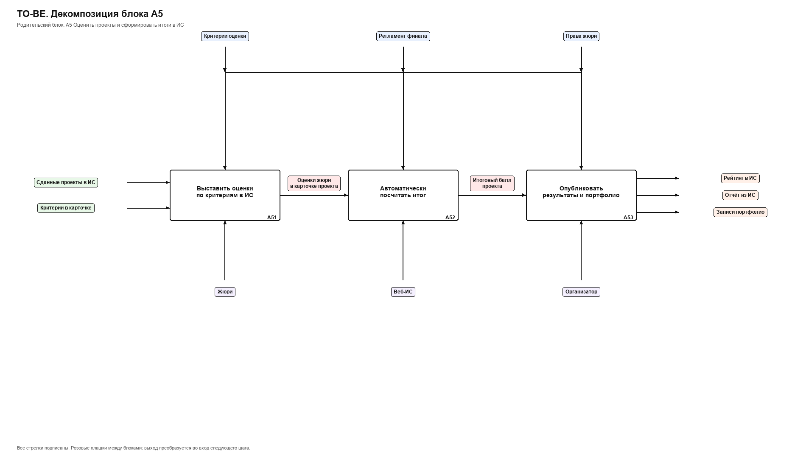

| Код | Функция |
|---|---|
| A51 | Выставить оценки по критериям в ИС |
| A52 | Автоматически посчитать итог |
| A53 | Опубликовать результаты и портфолио |

**Пояснение.**  
Жюри работает в интерфейсе ИС. Итог считается системой. Публикация результатов сразу обновляет портфолио. Ручное сведение баллов убирается.

---

## 13. Основные различия AS-IS и TO-BE

| Область | До внедрения ИС | После внедрения ИС |
|---|---|---|
| Заявки | Чаты, почта, разные формы | Единая форма и статусы в ИС |
| Команды и роли | Списки в таблицах | Карточки команд и ролей в ИС |
| Работа над проектом | Прогресс в переписке | Трекинг задач в ИС |
| Оценка жюри | Листы и ручной подсчёт | Оценки в ИС и автоподсчёт |
| Отчётность | Сборка вручную | Отчёты из системы |
| Портфолио | Почти отсутствует | Формируется при публикации итогов |
| Механизмы | Люди + таблицы + почта | Люди + веб-ИС + уведомления |
| Управление доступом | Слабо формализовано | Роли студента, наставника, организатора, жюри |

Вывод: внедрение ИС не меняет цель процесса, но меняет способ выполнения функций A2-A5. Основные потери AS-IS (потеря заявок, ошибки сведения, отсутствие портфолио) закрываются на уровне механизмов и выходов TO-BE.

---

## Список источников

1. Задание 3. Разработка модели бизнес-процессов с учётом внедрения информационной системы.
2. Материалы лекции SADT и IDEF0 (Духанов А.В.).
3. Отчёт по заданию 2: концепция ИС, вариант 5, выбор варианта C.
4. ГОСТ Р 59793-2021. Автоматизированные системы. Стадии создания.

---

## Приложение. Состав файлов

| Файл | Содержание |
|---|---|
| `images/01_as_is_a0.png` | AS-IS A-0 |
| `images/02_as_is_a0_decomp.png` | AS-IS первый уровень |
| `images/03_as_is_a2.png` | AS-IS декомпозиция A2 |
| `images/09_as_is_a3.png` | AS-IS декомпозиция A3 |
| `images/10_as_is_a4.png` | AS-IS декомпозиция A4 |
| `images/04_as_is_a5.png` | AS-IS декомпозиция A5 |
| `images/05_to_be_a0.png` | TO-BE A-0 |
| `images/06_to_be_a0_decomp.png` | TO-BE первый уровень |
| `images/07_to_be_a2.png` | TO-BE декомпозиция A2 |
| `images/11_to_be_a3.png` | TO-BE декомпозиция A3 |
| `images/12_to_be_a4.png` | TO-BE декомпозиция A4 |
| `images/08_to_be_a5.png` | TO-BE декомпозиция A5 |

Декомпозированы 4 блока первого уровня (A2, A3, A4, A5) до и после внедрения ИС.
