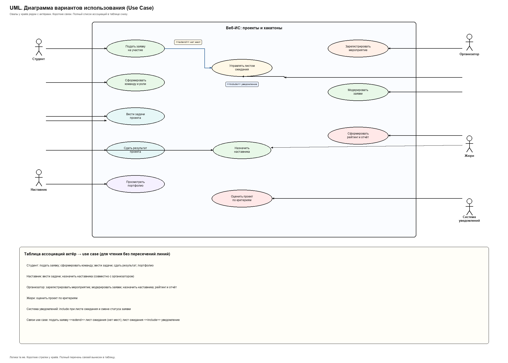
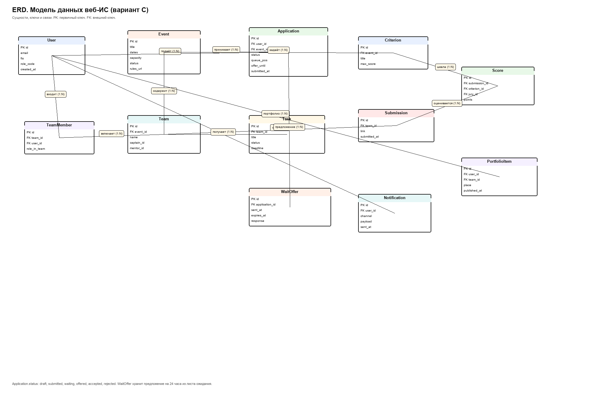
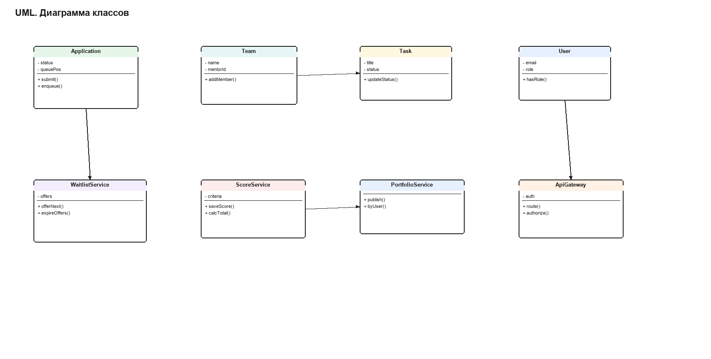
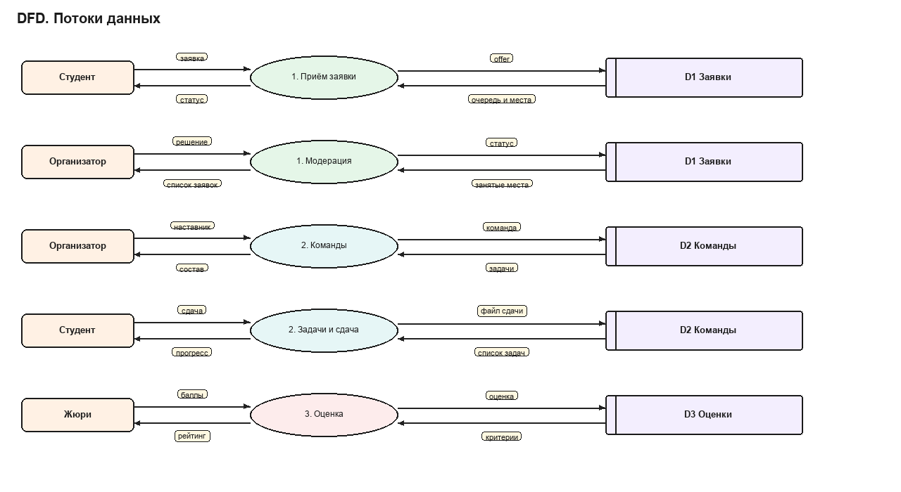
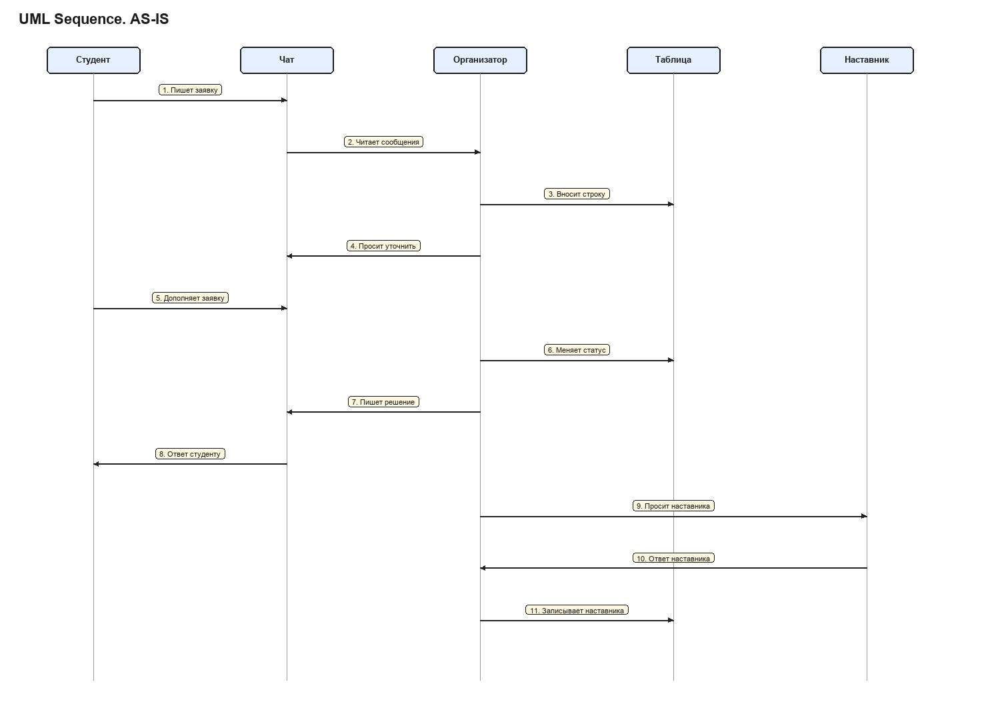
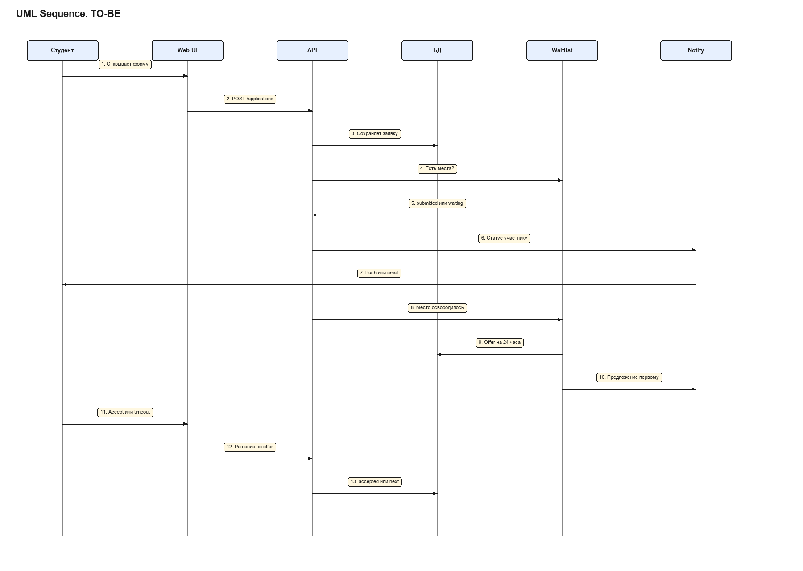
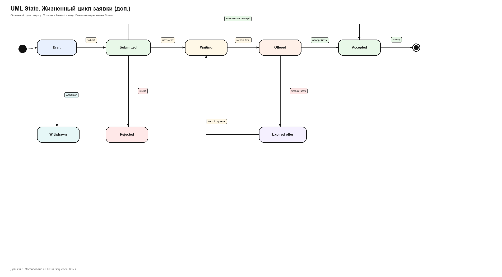
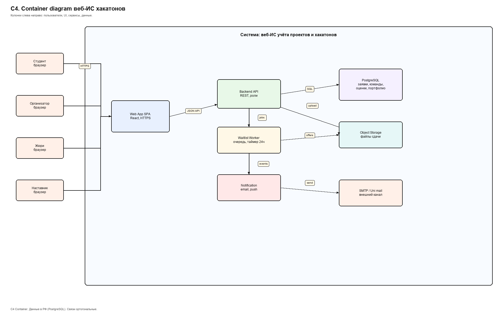
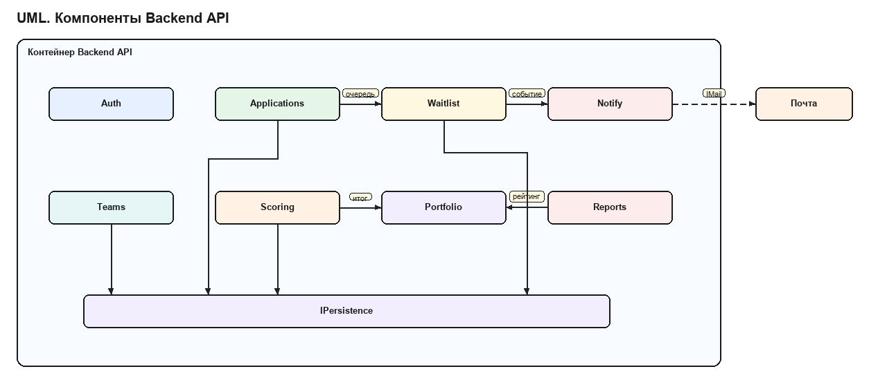
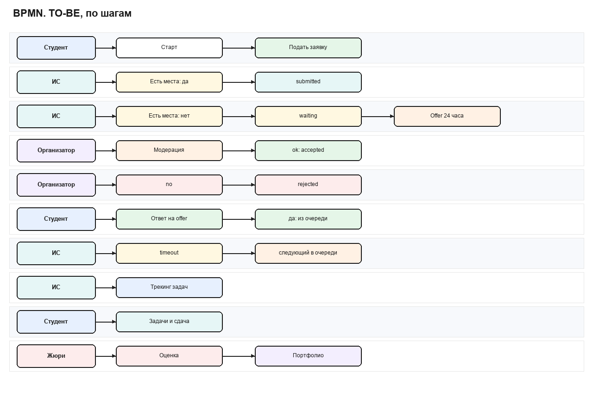

# Описание информационной системы с помощью различных нотаций

## Учёт студенческих проектов и хакатонов

**Дисциплина:** Проектирование информационных систем  
**Практическая работа:** Задание 4. Описание ИС с помощью различных нотаций  
**Вариант:** 5  
**Связь с заданием 2:** концепция собственной веб-ИС (вариант C)  
**Связь с заданием 3:** модель процессов IDEF0 AS-IS и TO-BE

### Состав команды и роли

| Участник | Роль |
|---|---|
| Соколов Никита | Руководитель проекта |
| Ашур Амир | Бизнес- и системный аналитик |
| Криличевский Максим | Архитектор |
| Медолазов Андрей | Специалист по ИБ, представитель заказчика |

### Кратко о предмете

Объект: организация студенческих проектов и хакатонов.  
В задании 2 выбран вариант C: собственное веб-приложение для мероприятий, заявок, команд, задач, оценки жюри, портфолио и отчётов.

В этой работе система описана несколькими нотациями: UML Use Case, ERD, UML Sequence, C4, обновлённый BPMN.  
Для доп. баллов добавлены UML class, DFD, диаграмма состояний и UML components.

Обозначения на рисунках:
- зелёные и цветные блоки для функций и сущностей;
- жёлтые подписи на связях и сообщениях;
- AS-IS показывает ручной контур, TO-BE опирается на ИС.

---

## 1. UML. Диаграмма вариантов использования

**Пояснение.**  
Актёры: студент, наставник, организатор, жюри, система уведомлений.  
Основные варианты использования покрывают цикл мероприятия: регистрация события, заявка, модерация, лист ожидания, команды и роли, задачи, сдача, оценка, рейтинг, портфолио.

Связи:
- `<<extend>>` от подачи заявки к листу ожидания при условии «нет мест»;
- `<<include>>` уведомления при работе с очередью и статусами.

Диаграмма опирается на функциональные требования Must из задания 2 и согласована с IDEF0 TO-BE из задания 3.

---

## 2. ERD. Модель данных

**Краткое описание диаграммы.**  
Центр модели: `Event`, `Application`, `Team`, `Task`, `Submission`, `Score`, `PortfolioItem`.  
Пользователь (`User`) связан с заявками, членством в команде, уведомлениями и портфолио.  
Для ограниченной вместимости добавлены поля очереди у заявки и сущность `WaitOffer` (предложение места на 24 часа).  
Оценка жюри хранится как `Score` по критериям `Criterion` для сдачи `Submission`.

Кардинальности типичные: одно мероприятие, много заявок и команд; одна команда, много задач и один актуальный результат сдачи; одна сдача, много оценок по критериям.

Статусы заявки: `draft`, `submitted`, `waiting`, `offered`, `accepted`, `rejected`.

### 2.1. Доп. UML. Диаграмма классов

**Пояснение.**  
Классы домена и сервисов показывают поведение рядом с ERD: `Application.enqueue()`, `WaitlistService.offerNext()`, `ScoreService.calcTotal()`, `PortfolioService.publish()`.  
`ApiGateway` отражает точку входа с проверкой ролей.

### 2.2. Доп. DFD

**Пояснение.**  
Внешние сущности: студент, организатор, жюри.  
Процессы 1.0, 2.0, 3.0 и координатор 0.  
Хранилища D1–D4 соответствуют группам таблиц ERD.  
DFD показывает потоки, которые ERD только хранит.

---

## 3. UML. Диаграммы последовательности AS-IS и TO-BE

### 3.1. AS-IS

**Пояснение.**  
Заявка идёт через чат и почту. Организатор вручную правит Excel и пишет ответы. Наставник назначается в личной переписке.  
Итог: нет единого статуса, нет таймера, легко потерять заявку.

### 3.2. TO-BE

**Пояснение.**  
Студент работает через Web UI. API сохраняет заявку, Waitlist Service проверяет места, Notify отправляет статус.  
При освобождении места создаётся `WaitOffer` на 24 часа. При timeout очередь сдвигается дальше.

### 3.3. Сравнение AS-IS и TO-BE

| Аспект | AS-IS | TO-BE |
|---|---|---|
| Канал заявки | чат, почта | веб-форма и API |
| Статус | в голове и в таблице | поле в БД |
| Нет мест | теряется или «в уме» | статус waiting и очередь |
| Освобождение места | руками в переписке | offer на 24 часа сервисом |
| Уведомление | случайное сообщение | Notify service |
| Назначение наставника | личные сообщения | данные команды в ИС |

Вывод: цель процесса та же, меняется способ фиксации и контроля сроков.

### 3.4. Доп. UML. Диаграмма состояний заявки

**Пояснение.**  
Состояния заявки согласованы с ERD и Sequence TO-BE: Draft, Submitted, Waiting, Offered, Accepted, Rejected, Expired offer, Withdrawn.  
Переход Offered → Expired offer по таймеру 24 часа возвращает логику к выбору следующего в очереди.

---

## 4. C4. Описание компонентов системы

**Пояснение.**  
Уровень Container:
- Web App (SPA, React);
- Backend API (REST, роли, бизнес-логика);
- Waitlist Worker (очередь и таймер 24 часа);
- Notification Service;
- PostgreSQL (данные в РФ);
- Object Storage для файлов сдачи;
- внешний SMTP или почта вуза.

Пользователи (студент, организатор, жюри, наставник) работают через HTTPS с Web App.  
Это закрывает нефункциональные требования задания 2: веб-доступ, роли, размещение данных в РФ.

### 4.1. Доп. UML. Диаграмма компонентов

**Пояснение.**  
Модули backend: Auth и Roles, Events, Applications, Waitlist, Teams, Tasks, Scoring, Portfolio, Reports, Notify Adapter.  
Все опираются на Persistence. Состав модулей совпадает с контейнерами C4 и сущностями ERD.

---

## 5. Обновление BPMN из работы 2

**Пояснение.**  
BPMN TO-BE из задания 2 пересмотрен после построения Use Case, ERD, Sequence и C4.

Что добавлено:
1. Шлюз «есть места?» после подачи заявки.
2. Ветка листа ожидания и `Offer +24ч`.
3. Шлюз accept или timeout с переходом к следующему в очереди.
4. Явные дорожки: студент, организатор, ИС, жюри.
5. Связка принятой заявки с трекингом задач, оценкой и портфолио.

Так BPMN перестаёт быть «отдельной картинкой» и согласуется с остальными нотациями.

---

## 6. Согласованность моделей (защита от претензий)

| Изменение | Где отражено | С чем согласовано |
|---|---|---|
| Лист ожидания | Use Case, ERD, State, Sequence TO-BE, BPMN, C4 Worker | статусы заявки и WaitOffer |
| Таймер 24 часа | State, Sequence, BPMN, WaitOffer.expires_at | Notification Service |
| Роли доступа | Use Case, C4, Components Auth | требования M2 из задания 2 |
| Оценка и портфолио | ERD Score и PortfolioItem, Sequence итог, BPMN жюри | IDEF0 A5 TO-BE из задания 3 |

Это же отвечает логике семинара «изменилось требование»: одно бизнес-правило проходит через несколько моделей и между ними есть явные связи.

---

## Список источников

1. Задание 4. Описание информационной системы с помощью различных нотаций.
2. Отчёт по заданию 2: концепция ИС, вариант 5, выбор варианта C.
3. Отчёт по заданию 3: модель бизнес-процессов IDEF0.
4. Материалы лекций по UML, ERD, C4 и BPMN.
5. ГОСТ Р 59793-2021. Автоматизированные системы. Стадии создания.

---

## Приложение. Состав файлов

| Файл | Содержание | Тип |
|---|---|---|
| `images/01_uml_use_case.png` | UML Use Case | обязательно |
| `images/02_erd.png` | ERD | обязательно |
| `images/03_uml_class.png` | UML class | доп. к п.2 |
| `images/04_dfd.png` | DFD | доп. к п.2 |
| `images/05_sequence_as_is.png` | Sequence AS-IS | обязательно |
| `images/06_sequence_to_be.png` | Sequence TO-BE | обязательно |
| `images/07_state_application.png` | State заявки | доп. к п.3 |
| `images/08_c4_containers.png` | C4 Container | обязательно |
| `images/09_uml_components.png` | UML components | доп. к п.4 |
| `images/10_bpmn_updated.png` | BPMN обновлённый | обязательно |

Обязательные пункты задания 4 закрыты. Дополнительные диаграммы включены.
